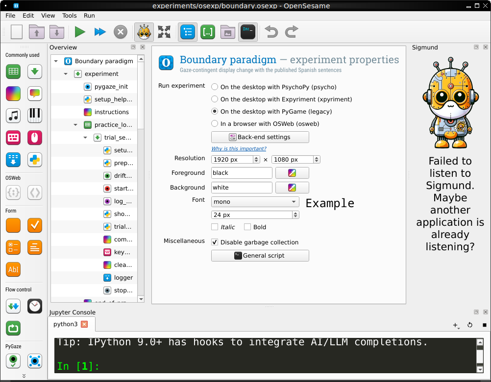
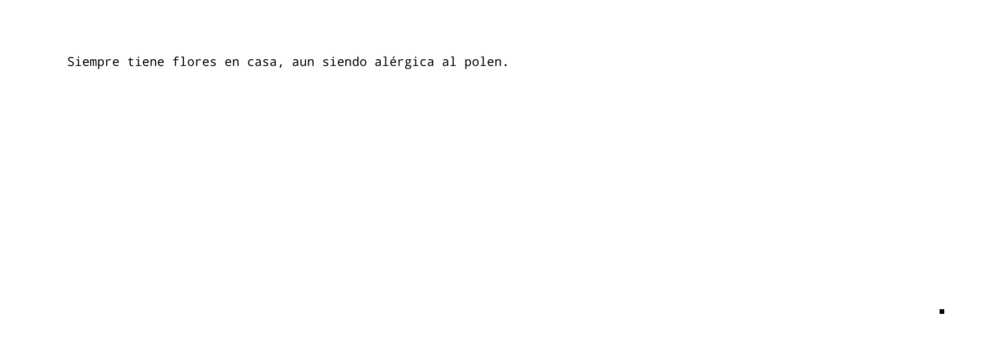
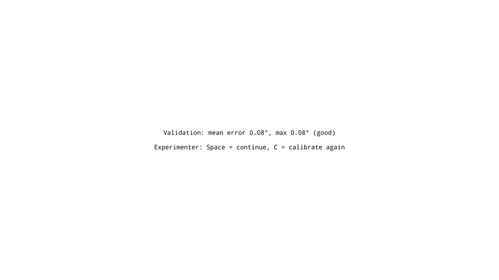
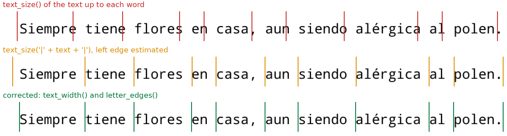
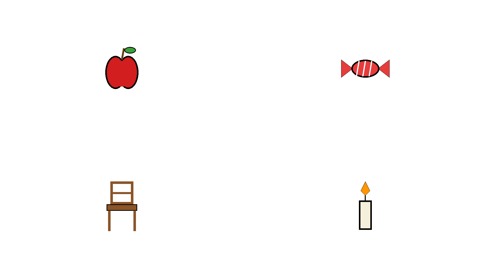

## Challenge 1: a published reading study

::: {.sentence-pair}
<span class="label">with comma</span> Siempre tiene flores en casa**,** aun siendo alérgica al polen.

<span class="label">without</span> Siempre tiene flores en casa aun siendo alérgica al polen.
:::

Angele, Gutiérrez-Cordero, Perea & Marcet (2023). Reading(,) with and without commas.
*Quarterly Journal of Experimental Psychology*.

- Spanish **requires** commas, e.g. before *aunque* or *aun*, but casual writers often leave them out.
  **Do readers slow down when a mandatory comma is missing?**
- Result: with commas, longer go-past time *before* the comma, but shorter reading times *after* it;
  no overall advantage. Commas shift **when** processing happens
- Originally programmed in EyeTrack (`examples/frases-comas/`). **Our challenge: rebuild it in OpenSesame**

## What does the study need?

The method section, translated into things we have to build:

| In the paper | What we need to learn |
|---|---|
| EyeLink 1000+, 1000 Hz; 3-point calibration, repeated when needed | eye tracking, calibration (Part 1); PyGaze (Part 2) |
| 130 sentences (+ 8 practice) with and without commas, 5 types × 26 | loops and variables (Part 2) |
| drift check, then a gaze target: the sentence appears after 250 ms on it | gaze-contingent trial start (Part 4) |
| the end of reading (a button press in the original; here: a look at a corner square) | the trial structure (Part 4) |
| comprehension questions after 34 sentences | sketchpads, responses (Parts 2, 4) |
| "each item seen equally often with and without commas, once per participant" | **counterbalancing** (Part 4) |
| reading times on the regions before and after the comma | interest areas, messages, data (Parts 4, 8) |

## What you will be able to do

By the end of the workshop you can:

1. **Explain** what an eye tracker records and why we calibrate
2. **Find your way** around an OpenSesame experiment (items, loops, variables)
3. **Build** a published reading study (challenge 1), a gaze-contingent boundary study
   (challenge 2) and a moving window (challenge 3), and **run** them *without* an eye tracker
4. **Read and change** the Python code that makes a display react to the eyes
5. **Know** what data you get and what to check before testing participants

. . .

No prior OpenSesame or eye-tracking experience is needed.
Some Python helps for part 4, but every line is explained.

## Plan

| Part | Topic |
|------|-------|
| 1 | Eye tracking in 10 minutes |
| 2 | OpenSesame in 15 minutes |
| 3 | Setup: run your first experiment |
| 4 | **Challenge 1**: the comma study (trial structure, counterbalancing, interest areas) |
| 5 | **Challenge 2**: a boundary study (display changes during saccades) |
| 6 | **Challenge 3**: the moving window |
| 7 | Switching gears: the visual world paradigm |
| 8 | Data, testing, and going to the lab |

# Part 1: Eye tracking in 10 minutes {background-color="#1f3a5f"}

## What an eye tracker measures

- A camera films the eye; software finds the **pupil** and a **corneal reflection**
- After calibration it reports a **gaze position** on the screen in pixels:
  a **sample**, typically 250–2000 times per second (EyeLink: 1000 Hz)
- From the samples, software derives **events**:
  - **Fixation**: the eye is (nearly) still, ~200–250 ms in reading; information is taken in
  - **Saccade**: a fast jump between fixations, ~20–40 ms; we are practically **blind** during it
  - **Blink**

::: {.callout-tip}
## Why this matters for the paradigms
Because vision is suppressed during a saccade, we can **change the screen while the eyes are moving**
and the reader does not notice. That is the boundary paradigm (challenge 2).
:::

## Fixations and saccades

::: {.anim data-anim="fixations" style="height: 640px"}
:::

The eyes **jump** (saccades) and **rest** (fixations). In reading, ~4 fixations per second.

## Calibration, validation, drift correction

- **Calibration**: the participant looks at 5–13 dots; the tracker learns the mapping
  *eye image → screen position*
- **Validation**: repeat the dots and check the error (aim for < 0.5° of visual angle)
- **Drift correction / drift check**: before each trial, one dot. If the gaze is off,
  re-calibrate. Head movement and fatigue make the mapping drift over time

In our experiments:

- `pygaze_init` calibrates once at the start, then `validate_calibration` measures the error
  in degrees (works with **every** tracker; see Part 4)
- `pygaze_drift_correct` runs at the start of **every trial**. Either the participant looks at the
  dot and the experimenter presses Space, or, with `fixation_triggered_drift_check = yes`, it accepts
  automatically once the participant fixates the dot
- If the participant cannot "trigger" the start of a trial, a drift correction is
  run again; the experimenter can also press **C** to re-calibrate (see Part 4)

## Gaze-contingent experiments

A **gaze-contingent** display changes depending on where the participant is looking.
Every gaze-contingent script is the same loop:

::: {.anim data-anim="loop" style="height: 600px"}
:::

- The loop has to be **fast**: poll as often as the tracker produces samples
- Everything that is slow (drawing text, loading images) is done **before** the loop

# Part 2: OpenSesame in 15 minutes {background-color="#1f3a5f"}

## OpenSesame in one slide

:::: {.columns}
::: {.column width="45%"}
- Free, open-source program for building experiments (<https://osdoc.cogsci.nl>)
- An experiment is a **tree of items**, shown in the **Overview** area
- Drag new items from the **toolbar** on the left; click an item to edit it
- Add **Python** (`inline_script`) where you need it
- **Plugins** add items, e.g. the **PyGaze** items (bottom left)
- The *Run* menu (or ▶) starts the experiment
:::
::: {.column width="55%"}
{.screenshot style="max-height: 600px"}
:::
::::

## The items you will meet

| Item | What it does |
|------|--------------|
| `sequence` | runs its items one after another |
| `loop` | runs one item many times, once per row of a **table** |
| `sketchpad` | shows a static display (text, shapes, images) |
| `keyboard_response` | waits for a key press and scores it |
| `logger` | writes one row with all variables to the data file |
| `inline_script` | your own Python code |

## Loops and variables

The rows of a `loop` table are your **trials**; the columns become **variables**.

| item | sentence_type | comma | no_comma | question | answer |
|------|---------------|-------|----------|----------|--------|
| 1 | concesiva | Paula no podrá irse de la clase, aunque … | Paula no podrá irse de la clase aunque … | NA | NA |
| 2 | concesiva | No aprobará el curso, pese a … | No aprobará el curso pese a … | ¿Aprobará el curso? | NO |

How you use a variable:

| Where | Syntax |
|-------|--------|
| text in a sketchpad | `{question}` |
| "Run if" condition in a sequence | `question != 'NA' and trial_aborted == 0` |
| Python in an `inline_script` | `var.question` |

## Prepare and run

OpenSesame runs every item in **two phases**:

1. **Prepare**: build the displays for the coming trial (slow work)
2. **Run**: show them and collect responses (time-critical)

An `inline_script` has a **Prepare** tab and a **Run** tab for the same reason.

::: {.anim data-anim="preparerun" style="height: 400px"}
:::

```python
# Prepare tab: draw the sentence before the trial starts
sentence_canvas = text_canvas(var.sentence)
```

```python
# Run tab: showing the prepared canvas takes ~1 ms
sentence_canvas.show()
eyetracker.log('STIMONSET')
```

## Two traps that silently corrupt your data

::: {.callout-warning}
## 1. Globals are variables
In OpenSesame 4, global variables in an inline script **are** experimental variables: `changed = True`
silently overwrites the loop column `changed`, and the wrong value ends up in your data file.
Never reuse a column name for a helper variable.
:::

::: {.callout-warning}
## 2. The log file's columns are fixed at the first trial
The `logger` decides the columns of the CSV file the first time it runs. A variable that is
created *later* (e.g. after the practice block) is **never written**. Create all variables
before the first trial, e.g. `counterbalance` runs before the practice loop.
:::

## Two coordinate systems

:::: {.columns}
::: {.column width="50%"}
**Canvas** (drawing)

- (0, 0) is the **centre** of the screen
- `c.rect(-860, -25, 50, 50)`
:::
::: {.column width="50%"}
**Eye tracker** (`eyetracker.sample()`)

- (0, 0) is the **top-left** corner
- on a 1920 × 1080 screen the centre is (960, 540)
:::
::::

Converting between them: `x_canvas = x_screen - W // 2`.
Mixing them up is the most common bug in gaze-contingent scripts.

## PyGaze: one experiment, any eye tracker

The `pygaze_init` item connects to the tracker and creates an object called **`eyetracker`**.
All our code only uses this object, so the same experiment runs on EyeLink, Tobii, SMI, EyeLogic, …

| Call | What it does |
|------|--------------|
| `eyetracker.sample()` | newest gaze position `(x, y)` in screen pixels |
| `eyetracker.log('msg')` | writes a time-stamped **message** into the tracker's data file |
| `eyetracker.drift_correction()` | shows a dot and checks/corrects the calibration |
| `eyetracker.start_recording()` / `stop_recording()` | start/stop saving samples |

Plugin items do the same without code: `pygaze_init`, `pygaze_drift_correct`,
`pygaze_start_recording`, `pygaze_log`, `pygaze_stop_recording`.

## Developing without an eye tracker

In `pygaze_init`, set **Tracker type**:

| Tracker type | When |
|--------------|------|
| **Advanced dummy (mouse simulation)** | developing and piloting: **the mouse pointer is your gaze** |
| EyeLink, Tobii, … | in the lab. Nothing else in the experiment changes |

With the advanced dummy:

- **Drift correction**: put the mouse on the dot and press **Space**
- Messages from `eyetracker.log()` are only printed in the console, *not* saved
- **Escape** pauses the experiment: **Space** resumes, **Q** quits

# Part 3: Setup {background-color="#1f3a5f"}

## Start the environment

**Option A: VS Code devcontainer (recommended)**

1. Open the repository folder in VS Code → *Reopen in Container*
2. Open <http://localhost:8080> in your browser: a Linux desktop (noVNC)
3. In the VS Code terminal: `opensesame &`. The window appears in the noVNC desktop

**Option B: Docker**

```bash
docker build -f .devcontainer/Dockerfile -t eye-workshop .
docker run -it --rm -p 8080:8080 -v "$PWD":/workspaces/experiments eye-workshop
bash .devcontainer/start-desktop.sh   # inside the container
```

**Option C: your own computer**: install OpenSesame 4.1 from <https://osdoc.cogsci.nl>
(PyGaze is included).

## Run your first experiment

1. *File → Open* → `experiments/osexp/reading.osexp`
2. Menu *Run → Run in window*
3. Subject number: `1`, keep the suggested log file
4. **Validation**: hold the mouse on each of the 5 dots in turn, then press Space to accept
5. Instructions: press any key
6. **Drift correction** (before every trial): mouse on the dot, press Space
7. **Move the mouse onto the black square** on the left and keep it there → the sentence appears
8. "Read" by moving the mouse to the right
9. Move the mouse to the **small square in the bottom-right corner** → the trial ends
10. After some sentences there is a question: answer with **1** (SÍ) or **2** (NO)

The experiment starts with 8 practice sentences, then 130 sentences. Stop any time with **Escape**, then **Q**.

::: {.callout-note}
## Exercise 1 (5 min)
Run `reading.osexp`. What happens if you never move onto the black square? (Wait 10 s.)
What happens if you press **C** while the black square is shown?
:::

# Part 4: Challenge 1: the comma study {background-color="#1f3a5f"}

## From the paper to a loop table

Each row of the loop table is one **item**, with both versions:

::: {.small-table}
| item | sentence_type | comma | no_comma | question | answer |
|------|---------------|-------|----------|----------|--------|
| 1 | concesiva | Paula no podrá irse de la clase, aunque acabe el examen pronto. | Paula no podrá irse de la clase aunque acabe el examen pronto. | NA | NA |
| 2 | concesiva | No aprobará el curso, pese a haberse esforzado el último trimestre. | No aprobará el curso pese a haberse esforzado el último trimestre. | ¿Aprobará el curso? | NO |
| 3 | concesiva | En verano habrá verbena, aunque prosigan las restricciones sanitarias. | En verano habrá verbena aunque prosigan las restricciones sanitarias. | NA | NA |
:::

. . .

But each participant may only read **one** of the two versions of each item. Which one?
That is the question of **counterbalancing**.

## One structure for all our experiments

::: {.anim data-anim="structure"}
:::

Only the **highlighted** items differ between the experiments. `reading.osexp` and `boundary.osexp`
run a practice loop first, then experimental blocks with breaks.

## A trial, step by step

::: {.anim data-anim="trial" style="height: 800px"}
:::

## Why the gaze target and the corner square?

{.screenshot style="max-height: 520px"}

- **Gaze target** (50 × 50 px at x = 100–150): the sentence only appears once the eyes are
  where the first word will be, so the first fixation lands on the first letter
- **Corner square**: looking at it for 100 ms ends the trial; the participant never needs a hand
  (the original study used a button press; both work, the corner keeps the hands free)
- **Question** only on some trials (`question != 'NA'`); 1 = SÍ (YES), 2 = NO

## The key helper: `wait_for_fixation`

Defined once in `setup_helpers`, used by every experiment:

```python
def wait_for_fixation(region, duration, timeout=None, keys=('escape',)):
    t0 = clock.time()
    since = None                       # when did the gaze enter the region?
    while True:
        x, y = eyetracker.sample()     # 1. where are the eyes?
        if region(x, y):               # 2. inside the region?
            if since is None:
                since = clock.time()
            elif clock.time() - since >= duration:
                return 'fixated'       # 3. long enough: done
        else:
            since = None               # left the region: start again
        key, _ = kb.get_key(keylist=list(keys), timeout=0)
        if key is not None:
            return key                 # e.g. 'escape' or 'c'
        if timeout is not None and clock.time() - t0 >= timeout:
            return 'timeout'
        clock.sleep(5)
```

`region` is a function such as `on_gaze_target(x, y)` or `on_corner(x, y)`.

## `wait_for_fixation` in action

::: {.anim data-anim="waitfix" style="height: 680px"}
:::

The same function waits for the gaze target (250 ms) and for the corner square (100 ms).

## When the gaze target is not triggered

On a real tracker, a participant who *is* looking at the target may not trigger it
because the calibration has drifted. So:

```python
while True:
    gazetarget_canvas.show()
    eyetracker.log('GAZE TARGET ON')
    result = wait_for_fixation(on_gaze_target, duration=250, timeout=10000,
                               keys=('escape', 'c'))
    if result == 'fixated':
        break
    eyetracker.stop_recording()          # (re)calibration needs recording off
    if result == 'c':
        eyetracker.log('GAZE TARGET RECALIBRATION')
        eyetracker.calibrate()
        calibrate_and_validate()
    else:
        eyetracker.log('GAZE TARGET %s: drift correction' % result.upper())
        eyetracker.drift_correction(
            fix_triggered=var.fixation_triggered_drift_check == 'yes')
    eyelink_draw_host()                  # EyeLink only; nothing otherwise
    eyetracker.start_recording()
```

- After 10 s (or Escape → Space): drift correction, then the target again
- Experimenter presses **C**: full calibration + validation, then the target again

## Experimenter controls

| When | Key | What happens |
|------|-----|--------------|
| validation result | **Space** / **C** | accept / calibrate again |
| gaze target (any time) | **C** | calibration + validation, then the same trial continues |
| gaze target, no fixation for 10 s | (automatic) | drift correction, then the same trial continues |
| any time | **Escape** | pause screen: **Space** resumes, **Q** quits (data so far are saved) |
| sentence on screen | **Escape** → Space | the trial is aborted (`trial_aborted = 1`, no question) |

The **status line** of the EyeLink Host PC shows `trial 12/220 item 35 dissimilar`
(set in `start_recording`); other trackers print it in the console.

## Validation: how accurate is the calibration?

{.screenshot}

- After every calibration, five dots; for each, the **median** gaze over 500 ms is compared with the dot
- The error is converted to **degrees of visual angle**: set `screen_width_cm` and
  `viewing_distance_cm` (experiment variables) for **your** lab
- Above `validation_threshold` (1°): calibrate again (**C**). Messages: `VALIDATION ERROR …`,
  `VALIDATION RESULT mean=… max=… accepted=1`; columns `validation_mean_error`, `validation_max_error`
- Works with every tracker. EyeLink also has its own validation in the calibration screen (**V**)

## Counterbalancing (1): why not show both versions?

If a participant reads *"Paula no podrá irse de la clase, aunque…"* and later
*"Paula no podrá irse de la clase aunque…"*, the second reading is **not** a fresh reading:

- they **remember** the sentence: fewer and shorter fixations, more skipping (**repetition effects**)
- they may **notice** the manipulation and start reading strategically
- whichever version comes second looks "easier", whatever the condition

So: **every participant reads every item once**, in **one** of the two conditions.

## Counterbalancing (2): why not let the items decide?

Simplest idea: items 1–65 always with commas, items 66–130 always without. **Don't**:

- Items differ in length, word frequency, plausibility, sentence type, …
- Any difference between the two halves is **confounded** with the condition:
  "readers were slower without commas" could just mean "items 66–130 are harder"
- You could never separate the effect of the comma from the effect of the item

. . .

We want **both**:

1. every item is read **with and without** commas (across participants)
2. every participant reads **both conditions** (within participants), and every item only once

## Counterbalancing (3): the solution, two lists

Split the participants into two groups and give each group a **list** (here: the first 6 of 130 items):

::: {.anim data-anim="lists" style="height: 600px"}
:::

- Within a participant: 65 items with commas, 65 without, **randomly interleaved**
- Across a pair of participants (one A, one B): every item in **both** conditions
- This is a **Latin square**: with *k* conditions you need *k* lists (boundary: 2; with 3 conditions: 3)
- Recruit participants in **multiples of the number of lists**, otherwise one list is over-represented

## Counterbalancing (4): is it balanced?

Alternating odd/even items spreads the conditions evenly over everything else, too.
For every participant in `reading.osexp`:

| | with comma | without comma |
|---|---|---|
| all items | 65 | 65 |
| block 1 / block 2 | 33 / 32 | 32 / 33 |
| each sentence type | 12–14 | 12–14 |
| items with a question | 17 | 17 |

(numbers for list A; list B is the mirror image)

. . .

If your items come in a meaningful order (e.g. sorted by type), alternating odd/even still
works; if they are sorted by *difficulty*, shuffle the item numbers first.

## Counterbalancing (5): the implementation

OpenSesame has a built-in variable `subject_parity` (`'odd'` or `'even'`), set from the subject number
you type in when the experiment starts. `prepare_trial`:

```python
var.item_list = 'A' if var.subject_parity == 'even' else 'B'
if var.block == 'practice':
    var.condition = 'practice'
    var.sentence = var.comma
else:
    odd_item = int(var.item) % 2 == 1
    with_comma = odd_item if var.item_list == 'A' else not odd_item
    var.condition = 'comma' if with_comma else 'no_comma'
    var.sentence = var.comma if with_comma else var.no_comma
sentence_canvas = text_canvas(var.sentence)
```

- `item_list`, `condition` and `sentence` are logged on every trial: the data file says exactly
  what each participant read
- (`item_list`, not `list`: a variable called `list` would hide Python's `list()` in every inline script)

## Counterbalancing (6): without Python

The same design with the graphical interface only:

1. Make **two loops**, `list_A_loop` and `list_B_loop`, each with one `sentence` column
   containing that list's version of every item
2. In the `experiment` sequence, give them **Run if** conditions:

| Item | Run if |
|------|--------|
| `list_A_loop` | `subject_parity == 'even'` |
| `list_B_loop` | `subject_parity == 'odd'` |

Easy to understand, but every item is now in two tables that must be kept in sync.
The Python version keeps both versions of an item in **one row**.

## Counterbalancing (7): order effects

Counterbalancing items is not enough: **when** a sentence is read matters too.
Readers get faster with practice and slower when tired.

- **Practice block** first (fixed order): the first, unrepresentative trials are not data
- **Random order** within each block (`order = random` in the loop): practice and fatigue
  effects are spread over both conditions
- **Breaks** between blocks
- If blocks differ in content, **rotate the block order** across participants
  (the boundary experiment does this, next section)

## Counterbalancing (8): check it, then analyse it

**Before** testing: run the experiment as subject 1 and as subject 2 (dummy tracker, or
`test_headless.py`) and check the log files:

```r
d <- rbind(read.csv("subject-1.csv"), read.csv("subject-2.csv"))
d <- subset(d, block != "practice")
table(d$item_list, d$condition)          # 65 / 65 in each list
all(table(d$item, d$condition) == 1)     # every item once in each condition
```

**Analysis**: participants *and* items are random samples. Use mixed-effects models with
crossed random effects for **participants and items**, e.g.
`lmer(log(duration) ~ condition + (1 + condition | subject_nr) + (1 + condition | item))`.

## Where is each word? Interest areas

The comma study compares reading times **before and after the comma**, so for every fixation we
need to know **which word and which letter** it was on.
So the experiment logs the position of every word (`REGION`) and letter (`LETTER`).

{style="max-height: 480px"}

**Red**: the obvious approach, measuring the text up to each word with `canvas.text_size()`.
The lines cut through the last letter of most words, up to **0.8 of a letter** off:
fixations near the end of a word are assigned to the wrong word.

## Why `text_size()` gets it wrong

`canvas.text_size(text)` does **not** return the space a text takes up. OpenSesame draws the text and
returns the size of the **inked pixels**:

| `text_size(...)` | returns | but on the screen |
|---|---|---|
| `'El '` | same as `'El'` | the space takes up 14 px |
| `'forma,'` | ends where the comma's ink ends | the comma's cell is wider |
| `center=True` (default) | ink only, also on the left | the first letter starts with empty pixels |

The correct measurement (`text_width()` in `setup_helpers`):

```python
def text_width(txt):
    # center=False: measure from where the text is drawn, not from the first ink;
    # '|' at the end: the empty pixels after the last letter (and spaces) now count
    return (_probe.text_size(txt + '|', center=False, html=False, max_width=W)[0]
            - _probe.text_size('|', center=False, html=False, max_width=W)[0])
```

- `letter_edges(sentence)` measures every prefix of the sentence; Qt also draws text 4 px to the right
  of `x` (its document margin), so the first letter starts at `SENTENCE_LEFT + 4`
- `experiments/check_interest_areas.py` compares this with the rendered pixels for every sentence:
  error **< 1.5 px** (legacy and psycho backends; Droid Sans Mono and Courier New)
- Works with any font, also proportional ones

## Advice: interest areas

- **Never use `text_size()` naively** to compute where letters and words are.
  Use `text_width()` / `letter_edges()`, or another method you have **checked against the screen**
- **Check visually**: draw the computed boundaries on the stimulus (as in the figure) and look at them
  before you collect data
- **Log the positions** in the data file, so that the analysis does not have to guess
- **Data already collected?** If the logged boundaries were computed with `text_size()`, as in
  `examples/ella_experiment_A.osexp`, do not use them: calculate the letter and word positions **by hand
  in the analysis**. In a monospace font this is simple: the first letter starts at the drawing x
  plus the text margin (about 4 px), and every character (also a space) is equally wide (font size × 0.6 for
  Courier New, 14.4 px at 24 px)

## Messages: the time line of a trial

Everything you need for the analysis is written to the tracker's data file with `eyetracker.log()`.

| Message | Meaning |
|---------|---------|
| `VALIDATION ERROR …`, `VALIDATION RESULT …` | accuracy after each calibration |
| `trial 12/138 item 35 comma`, `TRIALINFO item=…` | trial starts: number, item, condition |
| `GAZE TARGET ON` | gaze target shown |
| `GAZE TARGET TIMEOUT: drift correction`, `GAZE TARGET RECALIBRATION` | recovery during the trial |
| `STIMONSET` | sentence on screen: **time 0** for your measures |
| `REGION n=3 label=criticó left=… top=… right=… bottom=…` | every interest area (word / picture) |
| `LETTER word=3 n=1 char=c left=… right=…` | left and right edge of every letter |
| `DISPLAYCHANGE latency=…` | boundary crossed, display changed (boundary only) |
| `WINDOWMOVE char=…` | window moved (moving window only) |
| `PREVIEW_ONSET`, `AUDIO_ONSET`, `TARGET_ONSET`, `CLICK …` | visual world only |
| `TRIALEND` | corner fixated (or click); end of the trial |
| `TRIAL ABORTED`, `… TIMEOUT` | something went wrong; check these trials |
| `stop_trial` | recording stopped |

## Challenge 1: the code

```python
# Prepare (see Counterbalancing (5))
...
sentence_canvas = text_canvas(var.sentence)
letter_x = letter_edges(var.sentence)            # x of every letter edge
interest_areas = word_areas(var.sentence, letter_x)   # one box per word
```

```python
# Run
sentence_canvas.show()
eyetracker.log('STIMONSET')
log_interest_areas()                             # REGION messages
end_trial_at_corner()
```

- **Not gaze-contingent** during the sentence: the display does not change while reading
- Interest areas for the analysis: the word before the comma and the words after it;
  the letter positions show exactly where the comma was

::: {.callout-note}
## Exercise 2 (10 min)
Look up item 2 in the `trial_loop` table. Which version does **subject 7** read?
Which does **subject 8** read? Check your answer: run the experiment as subject 7, read a few
trials, quit (Escape, then Q), and look at `item`, `item_list`, `condition` and `sentence` in the log file.
:::

## Challenge 1: done

| In the paper | In `reading.osexp` |
|---|---|
| 130 + 8 sentences, 34 questions | `comas.csv` → practice loop + two blocks of 65 |
| drift check, 250 ms gaze target | `drift_correct`, `show_gaze_target` (`wait_for_fixation`) |
| end of reading | corner square, 100 ms (`end_trial_at_corner`) |
| counterbalancing | two lists by `subject_parity` (`item_list`, `condition`) |
| regions before and after the comma | `REGION` and `LETTER` messages, measured with `letter_edges()` |
| recalibration "whenever needed" | **C** during the gaze target; validation after every calibration |

Everything else in this workshop reuses this experiment: the next challenges only change
`prepare_trial` and `trial_display`.

# Part 5: Challenge 2: a boundary study {background-color="#1f3a5f"}

## Challenge 2: a boundary study

Serrano-Carot & Angele (2026). Spanish readers skip articles regardless of gender and number
agreement. *Journal of Eye Movement Research*, 19(1), 6. **Experiment 1**.

- Articles (*el*, *la*) are among the most frequent words, and readers often **skip** them.
  Do readers check whether the article **agrees** with the following noun **before** they look at it?
- Experiment 1: the **preview** of the article agrees with the noun (*la forma*) or does not
  (*el\* forma*); the correct article appears as soon as the eyes cross an invisible boundary
- Result: agreement did **not** change how often the article was skipped, but readers spent
  more time on the noun after a mismatching preview
- The original experiment is `examples/ella_experiment_A.osexp` (OpenSesame + PyGaze, EyeLink).
  **Our challenge: rebuild it** on top of challenge 1

New: the display changes **during a saccade** (gaze-contingent), timing matters, and three blocks of
sentences whose order has to be counterbalanced as well.

## The boundary paradigm

Rayner (1975): an **invisible boundary** is placed just before a target word.
Until the eyes cross it, the target position shows a **preview**; during the
saccade that crosses it, the preview is replaced by the target.

::: {.anim data-anim="boundary" style="height: 600px"}
:::

## Boundary: the materials

`boundary.osexp` rebuilds Experiment 1 (`examples/ella_experiment_A.osexp`) with its Spanish
sentences (`experiments/sentences.csv`); `changed` is the mismatching article preview:

| block | sentence_number | pretarget | target | posttarget | changed | question | answer |
|-------|-----------------|-----------|--------|------------|---------|----------|--------|
| 1 | 1 | El arquitecto criticó | la | forma de trabajar del albañil. | el | ¿El albañil criticó al arquitecto? | NO |

- 10 practice + 3 × 70 experimental sentences, breaks between blocks
- **Preview condition**: two lists, exactly as in the reading experiment: odd subject numbers see
  the even items with a dissimilar preview, even subject numbers the odd items. Practice is always identical

## Boundary: counterbalancing the block order

The sentences come in **three fixed blocks** of 70 (as in the published study).
If everyone read block 1 first and block 3 last, block 3 would always be read by tired, practised
readers: block content would be **confounded** with position.

So the **block order rotates** with `subject_nr % 3`, another Latin square:

::: {.anim data-anim="blocks" style="height: 440px"}
:::

- Each block appears once in each position (first, middle, last)
- Combined with the two preview lists (parity), there are 2 × 3 = **6 versions**;
  subjects 1–6 cover each once, so recruit in **multiples of 6**
- `block_order` is logged on every trial

## Boundary: rotating blocks in OpenSesame

The `counterbalance` script (before the practice block) picks the order:

```python
orders = {1: (1, 2, 3), 2: (2, 3, 1), 0: (3, 1, 2)}
var.block_at_1, var.block_at_2, var.block_at_3 = orders[var.subject_nr % 3]
```

The `experiment` sequence then contains every block loop at every position, with a **Run if** condition:

| Item | Run if |
|------|--------|
| `experimental_loop_1` | `block_at_1 == 1` |
| `experimental_loop_2` | `block_at_1 == 2` |
| `experimental_loop_3` | `block_at_1 == 3` |
| `break_instr` | always |
| `experimental_loop_1` | `block_at_2 == 1` |
| … | … |

## Boundary: the code

**Prepare**: build both displays and compute the boundary

```python
preview_word = var.changed if var.preview_condition == 'dissimilar' else var.target
pre_canvas = text_canvas(' '.join([var.pretarget, preview_word, ending]))
tar_canvas = text_canvas(' '.join([var.pretarget, var.target, ending]))
letter_x = letter_edges(tar_sentence)
# right edge of the last letter of the pre-target word + 0.4 of an X
var.boundary = letter_x[len(var.pretarget)] + 0.4 * text_width('X')
```

**Run**: poll as fast as possible (no `sleep`), change once

```python
pre_canvas.show()
while True:
    x, y = eyetracker.sample()
    if x > var.boundary:
        t_pre = clock.time()
        t_post = tar_canvas.show()
        var.display_change_latency = t_post - t_pre
        eyetracker.log('DISPLAYCHANGE latency=%d' % var.display_change_latency)
        break
```

## Boundary: timing

The change has to be **finished before the eyes land** (a saccade takes ~20–30 ms).

The delay between crossing and the new screen is the sum of:

1. **tracker latency**: a sample is available a few ms after the eye moved
2. **polling**: how often we call `sample()` (here: continuously)
3. **monitor**: waiting for the next refresh; 60 Hz = up to 16.7 ms, so use **≥ 120 Hz**

Check `display_change_latency` and exclude trials where the change happened during a fixation.
Test the timing on the **real setup** with the real tracker before collecting data.

# Part 6: Challenge 3: the moving window {background-color="#1f3a5f"}

## Challenge 3: the moving window

Rayner (2014). The gaze-contingent moving window in reading: Development and review.
*Visual Cognition*, 22(3–4), 242–258.

- McConkie & Rayner (1975): only the letters in a **window** around the fixation are shown;
  all others are replaced by `x`. If a smaller window does not slow reading, readers did not
  need the letters outside it
- This measures the **perceptual span**: in English, about 3–4 letters to the left and
  14–15 letters to the right of fixation; it is asymmetric in the direction of reading and
  depends on the writing system and on reading skill (see the review)
- We do not have a published moving-window experiment here: we build a demonstration with the
  sentences of `examples/EyeLogic_LITE.osexp`, reusing challenges 1 and 2

New: the display changes **on every saccade**, not once, and must not flicker while the eyes rest.

## The moving window (`movingwindow.osexp`)

::: {.anim data-anim="movingwindow" style="height: 380px"}
:::

- Materials: the 10 sentences of `examples/EyeLogic_LITE.osexp` (`experiments/movingwindow.csv`)
- Window = letters visible **on each side**: 4 (9 letters) or 12 (25 letters), counterbalanced
  with two lists, like the reading experiment

## Moving window: the code

**Prepare**: one canvas for every possible fixated letter, so that the run phase only calls `show()`

```python
def masked(centre):
    half = int(var.window)
    return ''.join(c if c == ' ' or abs(i - centre) <= half else 'x'
                   for i, c in enumerate(var.sentence))

window_canvases = [text_canvas(masked(i)) for i in range(len(var.sentence))]
```

**Run**: in the loop, convert gaze x to a letter (`gaze_char(x)` looks it up in the measured letter
edges `letter_x`) and show that letter's canvas … but not on every sample (next slide).

## Moving window: no flicker during a fixation

::: {.anim data-anim="windowlock" style="height: 600px"}
:::

A fixation can lie on the **boundary between two letters**; drift and tracker noise move the gaze
back and forth across it. So the window is **locked** during a fixation and only moves after a
**saccade** of at least `min_saccade_letters` (1.5 letters).

## Moving window: the lock in code

- **locked**: the window stays until the gaze is `min_saccade_letters` away from where it was locked
- **following** (during the saccade): the window follows the gaze, with a dead zone of half a letter,
  until the gaze has been still for 20 ms: the new fixation, lock again

```python
if not following and abs(x - locked_x) >= min_shift:
    following = True                       # a saccade started
    settle_x = settle_t = None
if following and not (letter_x[current] - dead_zone <= x
                      <= letter_x[current + 1] + dead_zone):
    char = min(max(gaze_char(x), 0), len(var.sentence) - 1)
    if char != current:
        window_canvases[char].show()
        eyetracker.log('WINDOWMOVE char=%d' % char)
        current = char
if following:
    if settle_x is None or abs(x - settle_x) > min_shift / 2:
        settle_x, settle_t = x, now        # still moving
    elif now - settle_t >= 20:
        following = False                  # fixation: lock the window
        locked_x = settle_x
```

# Part 7: Switching gears: the visual world {background-color="#1f3a5f"}

## Switching gears: the visual world

So far, people **read** and the display reacted to their eyes. In the visual world paradigm,
people **listen** while looking at pictures, and the eyes show how the spoken words are understood
over time.

- The same trial skeleton: drift correction, gaze target (now in the centre), messages, interest areas
- New: pictures and sound from the **file pool**, time 0 = the onset of a spoken word,
  and a **mouse click** as the response

## The visual world paradigm (`vwp.osexp`)

::: {.anim data-anim="vwp" style="height: 760px"}
:::

After Allopenna, Magnuson & Tanenhaus (1998): do the eyes go to the **competitor** (*candy*)
while hearing "*cand…*", before the word is over?

## Visual world: the materials

{.screenshot style="max-height: 450px"}

- 4 displays × 2 targets (*candle/candy*, *bell/belt*, *cat/cap*, *star/stairs*) + 2 unrelated distractors
- Pictures (PNG) and sounds (WAV) are in the experiment's **file pool**; `pool['candle.png']` gives the path
- `experiments/make_vwp_stimuli.py` draws the pictures and synthesises the sentences
  (carrier "*Click on the*" + word, spliced), so the **target-word onset** in each file is known: `target_onset`

## Visual world: the code

```python
# Prepare: pictures, sound, mouse
scene.image(pool[name + '.png'], x=x, y=y)           # for each of the 4 objects
instruction = Sampler(exp, pool[var.sound_file])     # loaded now, played later
mouse = Mouse(exp, visible=True)
```

```python
# Run
scene.show(); eyetracker.log('PREVIEW_ONSET'); clock.sleep(1000)
instruction.play()
t_audio = clock.time()
eyetracker.log('AUDIO_ONSET file=%s target_onset=%d' % (var.sound_file, int(var.target_onset)))
t_target = t_audio + int(var.target_onset)
while True:                                          # until a picture is clicked
    if not target_logged and clock.time() >= t_target:
        eyetracker.log('TARGET_ONSET')               # time 0 for the analysis
        target_logged = True
    button, position, t_click = mouse.get_click(timeout=0)
    ...
```

- Data: `clicked`, `click_correct`, `click_rt` (from target onset), `object_order`; `REGION` = the 4 pictures

::: {.callout-warning}
## Audio timing
`AUDIO_ONSET` is logged when `play()` returns; the sound reaches the loudspeakers later (sound-card buffer,
here 1024 samples / 48 kHz ≈ 21 ms, plus the driver). Measure this delay in the lab (microphone + photodiode)
and correct for it.
:::

# Part 8: Data, testing and the lab {background-color="#1f3a5f"}

## EyeLink extras: Host PC and Data Viewer

::: {.callout-important}
## Only with an SR Research EyeLink
Drawing on the experimenter's screen (the **Host PC**) and the `!V` messages for **Data Viewer** use
EyeLink-specific commands. With any other tracker, and with the dummy, the items `eyelink_setup`,
`eyelink_trial_start` and `eyelink_trial_end` **do nothing**: the experiment runs unchanged, but you get
no Host PC drawing.
:::

| Item | What it sends (EyeLink only) |
|------|------------------------------|
| `eyelink_setup` | `DISPLAY_COORDS 0 0 1919 1079` |
| `eyelink_trial_start` (before recording) | `TRIALID n`, one `!V IAREA RECTANGLE …` per interest area; draws gaze target, word boxes, **boundary line** (red) and corner square on the Host PC |
| `eyelink_trial_end` (after recording) | `!V TRIAL_VAR item …`, `condition`, `response`, `correct`, …; `TRIAL_RESULT 0` |

```python
EYELINK = items['pygaze_init'].var.tracker_type == 'EyeLink'
...
if EYELINK:
    eyetracker.send_command('draw_line %d 0 %d %d 4' % (var.boundary, var.boundary, H))
```

Data Viewer then shows trials, interest areas and condition variables without extra work.

## What data do you get?

| File | Content | Use |
|------|---------|-----|
| `subject-1.csv` (OpenSesame) | one row per trial, all variables: `item`, `item_list`, `condition`, `preview_condition`, `block_order`, `response`, `correct`, `display_change_latency`, `click_rt`, `validation_max_error`, … | conditions, accuracy, exclusions |
| tracker file (`sub_1.edf` for EyeLink) | all samples, fixations, saccades, **and your messages** | eye-movement measures |

Typical reading measures for a word, computed between `STIMONSET` and `TRIALEND`
using the `REGION` messages:

- **First fixation duration**, **gaze duration** (first pass), **go-past time**, **total time**
- **Skipping** and **regression** probabilities

Tools: EyeLink Data Viewer; in R e.g. `eyelinkReader` (read EDF files), `popEye` (reading measures),
`eyetrackingR` (visual world); in Python `pandas`.

## Testing without a participant

Two levels of testing:

1. **Manually**, with the advanced dummy: mouse = eyes; check every screen and the log file
2. **Automatically**: `experiments/test_headless.py` runs an experiment with a *simulated
   participant* (scripted gaze, keys and mouse clicks) and checks the data. It also ignores
   the gaze target once and presses C once, to test the recovery paths

```bash
python experiments/test_headless.py boundary --subject 2 --max-trials 4
python experiments/test_headless.py boundary --fake-eyelink   # test the EyeLink-only items
```

```
boundary (subject 2)
  PASS calibration validated and accepted before the first trial
  PASS ignored gaze target -> drift correction, trial continues
  PASS experimenter key C -> calibration + validation, trial continues
  PASS EyeLink-only items do nothing with another tracker
  PASS preview condition follows subject parity
  PASS block order rotates with subject_nr % 3 (2-3-1)
  ...
ALL PASSED
```

## Before you test real participants

- [ ] `pygaze_init`: the right **tracker type** (not the dummy!)
- [ ] Experiment resolution = **monitor resolution**; run **fullscreen**
- [ ] Monitor refresh rate **≥ 120 Hz** for display changes
- [ ] `screen_width_cm` and `viewing_distance_cm` set for your lab (validation in degrees)
- [ ] Visual world: measured **audio delay** (play → loudspeaker)
- [ ] Subject numbers: plan counterbalancing (reading: multiples of 2; boundary: multiples of 6);
      never reuse a subject number
- [ ] Font, size, and letters per degree of visual angle reported in your methods
- [ ] Calibrate and validate; know the keys: **C** re-calibrate, **Escape** pause
- [ ] Pilot with yourself: check `display_change_latency`, timeouts, aborted trials
- [ ] Check that the tracker file contains your messages
- [ ] Data are copied off the lab PC after every session

## Exercises

3. **Boundary** (15 min): open `prepare_trial` in `boundary.osexp`. Which preview does
   subject 2 see for sentence 1? Check it: run as subject 2, finish the practice, read a few
   trials, quit (Escape, then Q), and look at `sentence_number` and `preview_condition` in the log file.
4. **Moving window** (10 min): change `window` to 1 and to 15. How does "reading" with the mouse feel?
5. **Show the boundary** (10 min): in `prepare_trial` of `boundary.osexp`, draw a thin line at
   the boundary on `pre_canvas` (remember the coordinate systems!). Remove it again before data collection.
6. **Visual world** (15 min): add a ninth trial: draw two new pictures (or use your own PNGs),
   add them and a WAV file to the file pool, and add a row to `trial_loop` with the correct `target_onset`.
7. **Fixation-triggered drift check** (5 min): set `fixation_triggered_drift_check` to `yes`
   (experiment properties → variables) and run `reading.osexp`. What changes?
8. **Counterbalancing without Python** (20 min): in a copy of `reading.osexp`, replace the
   two-list logic by two loops with Run-if conditions (see Counterbalancing (6)). Use 6 items.

## Where the files come from

- The four `.osexp` files are **generated** by `experiments/build_osexp.py` from the stimulus
  tables (`comas.csv`, `sentences.csv`, `vwp_pool/`) and the code inside the script
- `extract_comas.py` (EyeTrack script → `comas.csv`) and `make_vwp_stimuli.py` (pictures + sounds)
  make the materials
- You can edit them in OpenSesame like any other experiment, but running the generator
  again **overwrites** them: save your own version under a new name
- `python experiments/build_osexp.py` → regenerate; then `python experiments/test_headless.py` → test

## Resources: software and methods

- OpenSesame documentation: <https://osdoc.cogsci.nl>
- PyGaze: <http://www.pygaze.org>, Dalmaijer, Mathôt & Van der Stigchel (2014), *Behavior Research Methods*
- GSAP (the animations in these slides): <https://gsap.com>
- Holmqvist et al. (2011). *Eye tracking: A comprehensive guide to methods and measures*. Oxford University Press
- Pollatsek & Well (1995). On the use of counterbalanced designs in cognitive research: A suggestion for a better and more powerful analysis. *JEP: Learning, Memory, and Cognition*
- Baayen, Davidson & Bates (2008). Mixed-effects modeling with crossed random effects for subjects and items. *Journal of Memory and Language*

## Resources: the studies and paradigms

- Angele, Gutiérrez-Cordero, Perea & Marcet (2023). Reading(,) with and without commas. *Quarterly Journal of Experimental Psychology*. <https://doi.org/10.1177/17470218231200338>
- Serrano-Carot & Angele (2026). Spanish readers skip articles regardless of gender and number agreement. *Journal of Eye Movement Research*, 19(1), 6. <https://doi.org/10.3390/jemr19010006>
- Rayner (2014). The gaze-contingent moving window in reading: Development and review. *Visual Cognition*, 22(3–4), 242–258. <https://doi.org/10.1080/13506285.2013.879084>
- Rayner (1975). The perceptual span and peripheral cues in reading. *Cognitive Psychology*
- McConkie & Rayner (1975). The span of the effective stimulus during a fixation in reading. *Perception & Psychophysics*
- Rayner (1998). Eye movements in reading and information processing: 20 years of research. *Psychological Bulletin*
- Allopenna, Magnuson & Tanenhaus (1998). Tracking the time course of spoken word recognition using eye movements. *Journal of Memory and Language*
- Huettig, Rommers & Meyer (2011). Using the visual world paradigm to study language processing. *Acta Psychologica*
